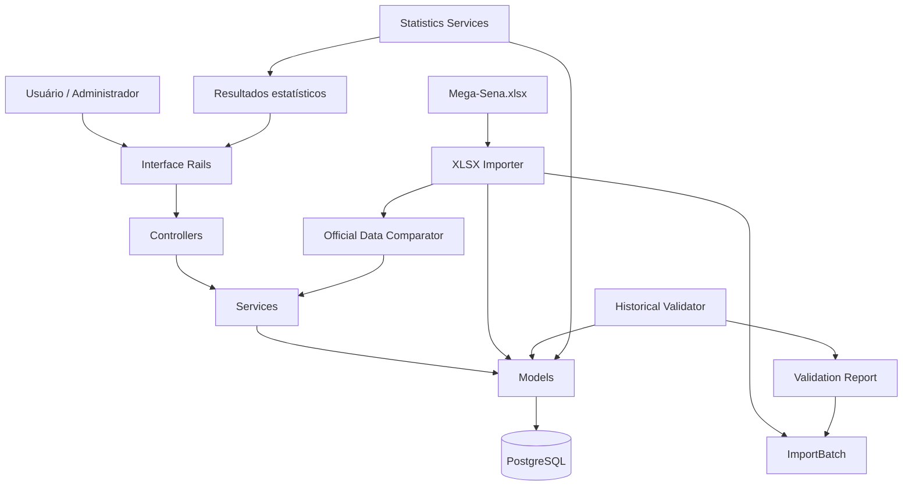
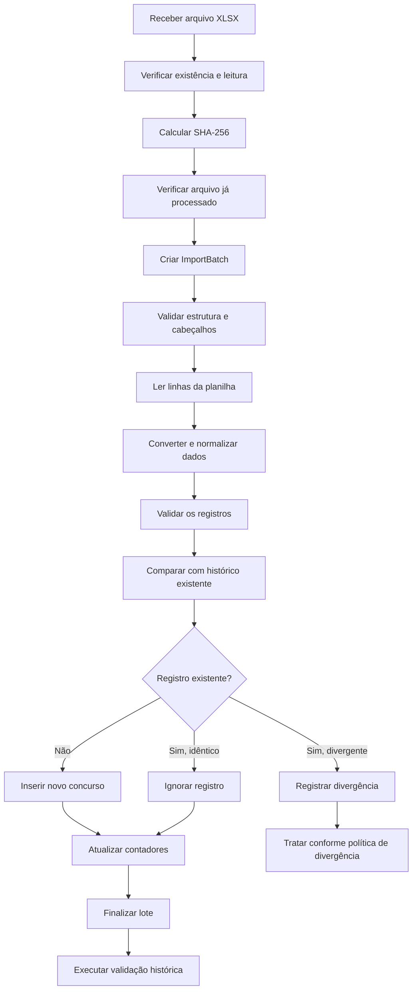

[← Voltar ao README](README.md)

---

# MegaStats — Arquitetura e Regras de Negócio

## 1. Visão geral

O **MegaStats** é uma aplicação desenvolvida em Ruby on Rails para armazenar, validar, auditar e analisar estatisticamente o histórico oficial dos sorteios da Mega-Sena.

O sistema utiliza os dados publicados pela Caixa Econômica Federal como fonte primária, mantendo uma base histórica estruturada em PostgreSQL.

A arquitetura foi concebida para separar as responsabilidades de importação, persistência, validação, análise estatística e apresentação, evitando que regras de negócio fiquem concentradas em controllers ou views.

### 1.1 Objetivos arquiteturais

Os principais objetivos são:

- Preservar a integridade dos resultados históricos.
- Permitir importações incrementais e repetíveis.
- Evitar a duplicação de concursos.
- Identificar inconsistências entre os dados importados e o histórico armazenado.
- Registrar a origem e o resultado de cada operação de importação.
- Executar validações independentes do processo de importação.
- Disponibilizar análises estatísticas reproduzíveis.
- Facilitar a inclusão de novas análises sem comprometer funcionalidades existentes.

### 1.2 Princípios adotados

| Princípio                       | Aplicação no MegaStats                                                       |
| ------------------------------- | ---------------------------------------------------------------------------- |
| Single Responsibility Principle | Cada serviço possui uma responsabilidade específica.                         |
| Separation of Concerns          | Controllers, models, services e views têm responsabilidades distintas.       |
| DRY                             | Regras compartilhadas não devem ser duplicadas.                              |
| Fail Fast                       | Dados inválidos devem ser identificados antes de comprometer a persistência. |
| Data Integrity                  | Validações da aplicação são complementadas por constraints no PostgreSQL.    |
| Auditability                    | Toda importação deve deixar um registro rastreável.                          |
| Idempotency                     | Reprocessar os mesmos dados não deve duplicar concursos.                     |
| Testability                     | Regras de negócio devem poder ser testadas independentemente da interface.   |

---

## 2. Tecnologias e componentes

| Componente     | Tecnologia                 | Responsabilidade                        |
| -------------- | -------------------------- | --------------------------------------- |
| Backend        | Ruby on Rails 8.1          | Estrutura principal da aplicação.       |
| Linguagem      | Ruby 3.3+                  | Implementação das regras de negócio.    |
| Banco de dados | PostgreSQL                 | Persistência e integridade dos dados.   |
| Interface      | Tailwind CSS               | Apresentação e responsividade.          |
| Interatividade | Hotwire / Turbo / Stimulus | Atualizações e interações da interface. |
| JavaScript     | esbuild                    | Compilação dos recursos JavaScript.     |
| Importação     | Roo                        | Leitura de arquivos Excel.              |
| Testes         | Minitest                   | Testes unitários e de integração.       |

---

## 3. Arquitetura lógica

A aplicação é organizada em camadas com responsabilidades específicas.



### 3.1 Camada de apresentação

Responsável pela interação com o usuário.

Principais responsabilidades:

- Apresentar o histórico de concursos.
- Disponibilizar o formulário de importação.
- Exibir o histórico de lotes de importação.
- Apresentar os detalhes de cada lote.
- Permitir a execução e visualização das validações.
- Exibir os resultados das análises estatísticas.

A camada de apresentação não deve implementar regras estatísticas ou manipular diretamente a estrutura de importação.

### 3.2 Controllers

Os controllers recebem as requisições, validam os parâmetros de entrada, acionam os serviços necessários e preparam os dados para as views.

Responsabilidades:

- Receber e validar parâmetros HTTP.
- Autorizar operações conforme as regras de acesso da aplicação.
- Acionar serviços de domínio.
- Tratar resultados e exceções.
- Definir respostas HTML ou Turbo Stream.

Controllers não devem conter:

- Cálculos estatísticos complexos.
- Leitura direta de planilhas.
- Regras de comparação entre concursos.
- Rotinas de auditoria histórica.
- Regras de persistência que pertençam aos serviços ou models.

### 3.3 Camada de serviços

A camada de serviços concentra os processos de negócio.

Estrutura de referência:

```text
app/
└── services/
    └── mega_sena/
        ├── xlsx_importer.rb
        ├── historical_validator.rb
        ├── official_data_comparator.rb
        └── statistics/
            └── winner_range_analysis.rb
```

Responsabilidades esperadas:

| Serviço                | Responsabilidade                                                        |
| ---------------------- | ----------------------------------------------------------------------- |
| XlsxImporter           | Ler, interpretar e importar os dados da planilha.                       |
| OfficialDataComparator | Comparar dados oficiais com registros existentes.                       |
| HistoricalValidator    | Auditar a integridade do histórico armazenado.                          |
| WinnerRangeAnalysis    | Analisar as dezenas dos concursos selecionados por faixa de ganhadores. |

As análises estatísticas futuras devem ser implementadas em serviços independentes.

---

## 4. Modelo de dados

O núcleo da persistência é composto pelas entidades `Draw` e `ImportBatch`.

### 4.1 Entidade Draw

Representa um concurso da Mega-Sena.

Cada registro corresponde a um resultado oficial.

Principais atributos:

| Campo                    | Tipo conceitual | Descrição                                            |
| ------------------------ | --------------- | ---------------------------------------------------- |
| contest_number           | Integer         | Número único do concurso.                            |
| draw_date                | Date            | Data do sorteio.                                     |
| number_1                 | Integer         | Primeira dezena sorteada.                            |
| number_2                 | Integer         | Segunda dezena sorteada.                             |
| number_3                 | Integer         | Terceira dezena sorteada.                            |
| number_4                 | Integer         | Quarta dezena sorteada.                              |
| number_5                 | Integer         | Quinta dezena sorteada.                              |
| number_6                 | Integer         | Sexta dezena sorteada.                               |
| winners_sena             | Integer         | Quantidade de ganhadores com seis acertos.           |
| prize_sena               | Decimal         | Rateio da faixa principal.                           |
| winners_quina            | Integer         | Quantidade de ganhadores com cinco acertos.          |
| prize_quina              | Decimal         | Rateio da Quina.                                     |
| winners_quadra           | Integer         | Quantidade de ganhadores com quatro acertos.         |
| prize_quadra             | Decimal         | Rateio da Quadra.                                    |
| city_uf                  | String          | Cidade e unidade federativa, quando disponíveis.     |
| accumulated_sena         | Decimal         | Valor acumulado da faixa principal.                  |
| total_revenue            | Decimal         | Arrecadação total do concurso.                       |
| estimated_prize          | Decimal         | Estimativa do prêmio.                                |
| special_draw_accumulated | Decimal         | Acumulado para o sorteio especial, quando informado. |
| observation              | Text            | Observações oficiais.                                |
| source_metadata          | JSONB           | Metadados complementares da origem.                  |
| import_batch_id          | Foreign Key     | Lote responsável pela importação do registro.        |

Relacionamento:

```text
ImportBatch 1 -------- N Draw
```

Um lote pode estar associado a vários concursos. Um concurso pode ter um lote de importação associado ou permanecer sem associação, conforme a origem de sua inclusão.

### 4.2 Entidade ImportBatch

Representa uma execução de importação de dados.

Sua finalidade é manter o histórico operacional e permitir auditoria.

Principais atributos:

| Campo             | Descrição                                              |
| ----------------- | ------------------------------------------------------ |
| file_name         | Nome do arquivo importado.                             |
| file_sha256       | Hash SHA-256 do arquivo.                               |
| status            | Situação do processamento.                             |
| total_rows        | Total de linhas consideradas.                          |
| inserted_rows     | Registros inseridos.                                   |
| updated_rows      | Registros atualizados, quando aplicável.               |
| skipped_rows      | Registros ignorados por já existirem sem divergências. |
| error_rows        | Quantidade de linhas com erros.                        |
| error_details     | Detalhamento dos erros encontrados.                    |
| validation_report | Resultado da validação histórica associada.            |
| started_at        | Início do processamento.                               |
| finished_at       | Encerramento do processamento.                         |

Estados do lote:

| Status     | Significado                            |
| ---------- | -------------------------------------- |
| pending    | Lote criado, aguardando processamento. |
| processing | Importação em andamento.               |
| succeeded  | Processamento concluído com sucesso.   |
| failed     | Processamento encerrado com falha.     |

O status do lote deve representar o resultado do processamento. O resultado da auditoria deve permanecer disponível separadamente em `validation_report`.

Assim, é possível distinguir uma falha de leitura/importação de uma inconsistência identificada durante a validação histórica.

### 4.3 Integridade no PostgreSQL

As regras críticas devem ser protegidas tanto no model quanto no banco de dados.

Restrições importantes:

- `contest_number` deve ser positivo.
- `contest_number` deve ser único.
- Cada dezena deve estar entre 1 e 60.
- As seis dezenas de um concurso devem ser distintas.
- Os valores financeiros não podem ser negativos.
- As quantidades de ganhadores não podem ser negativas.

Os índices devem atender às consultas mais frequentes:

- Número do concurso.
- Data do sorteio.
- Lote de importação.
- Arrecadação total.

A aplicação deve preservar as constraints do banco mesmo quando os dados forem inseridos por tarefas, scripts ou serviços que não utilizem a interface web.

---

## 5. Regras de negócio — resultados da Mega-Sena

### RN-001 — Quantidade de dezenas por concurso

Cada concurso deve possuir exatamente seis dezenas sorteadas.

### RN-002 — Intervalo permitido

Cada dezena deve pertencer ao intervalo de 1 a 60, inclusive.

### RN-003 — Não repetição de dezenas

As seis dezenas de um mesmo concurso devem ser distintas.

Exemplo válido:

```text
04 - 17 - 23 - 35 - 42 - 58
```

Exemplo inválido:

```text
04 - 17 - 23 - 35 - 42 - 42
```

### RN-004 — Identificação do concurso

Cada concurso deve possuir um número inteiro positivo e exclusivo.

Não podem existir dois registros com o mesmo número de concurso.

### RN-005 — Data do sorteio

A data do sorteio deve ser válida e obrigatória para os registros históricos oficiais.

### RN-006 — Informações financeiras

Os valores monetários devem ser armazenados em campos decimais, nunca em ponto flutuante binário.

Valores financeiros não podem ser negativos.

Campos não informados pela fonte devem ser tratados conforme a semântica do dado, sem transformar automaticamente ausência de informação em zero.

### RN-007 — Quantidade de ganhadores

As quantidades de ganhadores devem ser inteiros não negativos.

A ausência de informação e o valor zero não devem ser confundidos quando a fonte não fornecer explicitamente essa distinção.

### RN-008 — Origem dos dados

Os dados históricos oficiais devem ser originados da publicação da Caixa Econômica Federal.

Informações complementares devem preservar sua origem e não substituir silenciosamente valores oficiais.

---

## 6. Processo de importação oficial

A importação é uma das operações mais importantes do MegaStats.

Seu objetivo é incorporar novos concursos sem duplicar registros e sem alterar silenciosamente informações históricas já armazenadas.

### 6.1 Arquivo de origem

O arquivo oficial utilizado é:

```text
storage/imports/Mega-Sena.xlsx
```

A tarefa de importação também permite informar outro caminho por meio da variável:

```bash
MEGA_SENA_XLSX=/caminho/para/Mega-Sena.xlsx
```

A planilha deve possuir os cabeçalhos esperados pelo importador, incluindo:

- Concurso
- Data do Sorteio
- Bola1
- Bola2
- Bola3
- Bola4
- Bola5
- Bola6

Os demais campos oficiais são mapeados para seus atributos correspondentes no model `Draw`.

O importador deve validar os cabeçalhos obrigatórios antes de iniciar a persistência.

### 6.2 Fluxo de importação



### 6.3 Identificação do arquivo

O sistema calcula o SHA-256 do arquivo recebido.

O hash permite identificar se o conteúdo do arquivo já foi processado.

Regra:

- Arquivo com o mesmo hash de uma importação anterior bem-sucedida não precisa ser processado novamente.
- Arquivo com hash diferente pode conter novos concursos ou correções e deve passar pelo fluxo normal de comparação.

O hash identifica o conteúdo binário do arquivo, não a equivalência semântica das linhas. Portanto, uma planilha salva novamente pode possuir outro hash mesmo que os resultados sejam iguais.

### 6.4 Comparação de concursos

A identificação de um concurso existente deve utilizar `contest_number`.

Para cada linha:

**Cenário A — Concurso inexistente**

O registro deve ser inserido após a validação dos dados.

**Cenário B — Concurso existente e dados idênticos**

O registro deve ser ignorado, sem duplicação.

**Cenário C — Concurso existente com dados divergentes**

O sistema deve identificar e registrar a divergência.

Uma divergência não deve ser tratada como autorização automática para sobrescrever o histórico.

Correções oficiais devem ser submetidas a um procedimento controlado de reconciliação, com identificação dos campos alterados e rastreabilidade da origem.

### 6.5 Importação incremental

O processo deve permitir que uma nova planilha contenha tanto concursos antigos quanto concursos recentes.

Exemplo:

| Concurso | Situação no banco   | Resultado esperado |
| -------- | ------------------- | ------------------ |
| 1        | Existe e é idêntico | Ignorar            |
| 2        | Existe e é idêntico | Ignorar            |
| 3.078    | Não existe          | Inserir            |
| 3.079    | Não existe          | Inserir            |
| 3.080    | Não existe          | Inserir            |

Esse comportamento permite importar a planilha histórica completa repetidamente sem duplicar os registros.

### 6.6 Contabilização

Ao finalizar a importação, o lote deve registrar:

```text
total_rows
inserted_rows
updated_rows
skipped_rows
error_rows
```

Os contadores devem refletir o processamento efetivamente realizado.

Não se deve contabilizar uma linha como inserida antes de sua persistência ser confirmada.

### 6.7 Tratamento de falhas

Erros devem ser registrados em `error_details`, sempre que possível com:

- Número da linha.
- Número do concurso.
- Campo envolvido.
- Valor recebido.
- Descrição do problema.

O processamento deve evitar deixar o histórico em estado parcialmente atualizado quando ocorrer uma falha que exija reversão.

A persistência dos registros e a atualização dos contadores devem obedecer a uma estratégia transacional coerente.

O registro operacional do lote, por sua vez, deve permanecer disponível para auditoria, inclusive quando a importação falhar.

---

## 7. Validação e auditoria histórica

A importação verifica os dados recebidos. A validação histórica verifica a consistência do conjunto armazenado.

São responsabilidades diferentes e complementares.

O serviço responsável é:

```text
app/services/mega_sena/historical_validator.rb
```

### 7.1 Objetivos

A validação deve verificar:

1. Existência de concursos.
2. Números de concursos duplicados.
3. Lacunas na sequência histórica.
4. Datas ausentes ou inválidas.
5. Datas duplicadas, conforme a regra de negócio adotada.
6. Dezenas fora do intervalo permitido.
7. Dezenas repetidas dentro de um concurso.
8. Quantidade correta de dezenas por concurso.
9. Valores financeiros negativos.
10. Quantidades de ganhadores inválidas.

A validação deve consultar o banco de dados, independentemente da origem dos registros.

### 7.2 Estados da validação

| Status  | Interpretação                                                                                     |
| ------- | ------------------------------------------------------------------------------------------------- |
| passed  | Todas as verificações obrigatórias foram aprovadas.                                               |
| warning | Foram encontradas situações que merecem atenção, mas não impedem necessariamente o uso dos dados. |
| failed  | Foi encontrada uma inconsistência crítica.                                                        |

O relatório deve identificar quais verificações foram executadas e quais problemas foram encontrados.

### 7.3 Lacunas na sequência de concursos

A sequência de números de concursos deve ser analisada entre o menor e o maior número armazenado.

Exemplo:

```text
100
101
102
104
105
```

Nesse caso, o concurso 103 está ausente.

Uma lacuna deve ser registrada como inconsistência para investigação. Entretanto, sua classificação como falha ou alerta deve considerar a abrangência da fonte histórica e a existência de concursos oficialmente cancelados ou outras particularidades documentadas.

### 7.4 Datas duplicadas

A identificação de datas duplicadas deve considerar a regra histórica adotada pelo sistema.

Uma ocorrência deve ser reportada para investigação, mas não deve ser interpretada automaticamente como duplicidade de concurso: o identificador primário do resultado continua sendo `contest_number`.

### 7.5 Relatório de validação

O resultado deve ser armazenado em:

```text
import_batches.validation_report
```

Estrutura conceitual:

```json
{
  "status": "passed",
  "checked_at": "2026-11-02T12:00:00Z",
  "checks": {
    "contest_numbers": {
      "status": "passed"
    },
    "missing_contests": {
      "status": "passed",
      "count": 0
    },
    "draw_dates": {
      "status": "passed"
    },
    "draw_numbers": {
      "status": "passed"
    }
  },
  "errors": [],
  "warnings": []
}
```

O exemplo é ilustrativo. A estrutura efetivamente persistida deve corresponder ao formato implementado pelo serviço.

O relatório deve permitir entender o estado do histórico no momento da execução.

---

## 8. Análise estatística por faixa de ganhadores

Uma das análises previstas no MegaStats utiliza a quantidade de ganhadores da faixa principal (`winners_sena`) como critério de seleção dos concursos.

Serviço de referência:

```text
app/services/mega_sena/statistics/winner_range_analysis.rb
```

### 8.1 Objetivo

Permitir que o usuário informe uma quantidade mínima e máxima de ganhadores da Sena e obtenha a frequência das dezenas sorteadas nos concursos que atendam ao filtro.

Exemplo:

```text
Mínimo de ganhadores: 0
Máximo de ganhadores: 0
```

Nesse cenário, são considerados somente os concursos sem ganhadores da faixa principal.

### 8.2 Regra de seleção

A seleção deve utilizar um intervalo inclusivo:

\[
min \leq winners_sena \leq max
\]

Os limites mínimo e máximo devem ser inteiros não negativos.

O limite mínimo não pode ser maior que o máximo.

### 8.3 Cálculo das frequências

Para cada dezena de 01 a 60, o serviço calcula:

- Quantidade de vezes sorteada.
- Quantidade de vezes não sorteada.
- Percentual de ocorrência.
- Percentual de não ocorrência.

Seja:

- \(N\): quantidade de concursos selecionados.
- \(F_i\): quantidade de vezes que a dezena \(i\) apareceu.
- \(A_i\): quantidade de concursos em que a dezena \(i\) não apareceu.

Então:

\[
A_i = N - F_i
\]

Percentual de ocorrência:

\[
P_i = \frac{F_i}{N} \times 100
\]

Percentual de não ocorrência:

\[
Q_i = \frac{A_i}{N} \times 100
\]

Para cada dezena:

\[
P_i + Q_i = 100\%
\]

Quando nenhum concurso satisfizer o filtro, os percentuais devem ser apresentados como não aplicáveis, evitando divisão por zero.

### 8.4 Exemplo ilustrativo

Considere que o filtro tenha selecionado 100 concursos.

| Dezena | Sorteada | Não sorteada | Ocorrência | Não ocorrência |
| ------ | -------: | -----------: | ---------: | -------------: |
| 01     |       12 |           88 |        12% |            88% |
| 02     |       18 |           82 |        18% |            82% |
| 03     |        9 |           91 |         9% |            91% |
| 04     |       21 |           79 |        21% |            79% |

Os números acima são apenas ilustrativos.

### 8.5 Regras importantes

- O filtro deve utilizar `winners_sena`, e não a quantidade de ganhadores da Quina ou Quadra.
- Os limites são inclusivos.
- Cada concurso selecionado deve contribuir com exatamente seis ocorrências.
- Cada dezena pode aparecer no máximo uma vez por concurso.
- O universo analisado deve conter as 60 dezenas.
- A quantidade de ocorrências e não ocorrências deve ser calculada em relação ao total de concursos selecionados.
- O resultado deve ser reproduzível para a mesma base histórica e os mesmos parâmetros.

### 8.6 Interpretação estatística

A frequência histórica é uma medida descritiva do passado.

Uma dezena que apareceu mais vezes em determinado subconjunto de concursos não possui, por esse motivo, maior probabilidade de ser sorteada no próximo concurso.

Da mesma forma, uma dezena que apareceu menos vezes não está estatisticamente obrigada a compensar sua ausência.

Os sorteios são eventos independentes, e as análises do MegaStats não devem apresentar frequências históricas como previsões ou garantias de resultados futuros.

---

## 9. Arquitetura das futuras análises estatísticas

As próximas análises devem ser implementadas como serviços independentes, seguindo o mesmo padrão de separação de responsabilidades.

Estrutura planejada:

```text
app/services/mega_sena/statistics/
├── winner_range_analysis.rb
├── frequency_analyzer.rb
├── parity_analyzer.rb
├── sum_analyzer.rb
├── sequence_analyzer.rb
├── delay_analyzer.rb
└── combination_analyzer.rb
```

### 9.1 FrequencyAnalyzer

Responsável pela frequência histórica das dezenas.

Possíveis dimensões:

- Frequência geral das dezenas de 01 a 60.
- Frequência nos últimos 10 concursos.
- Frequência nos últimos 20 concursos.
- Frequência nos últimos 30 concursos.
- Frequência em períodos definidos pelo usuário.

A seleção dos concursos deve ser ordenada por número ou data de forma consistente.

### 9.2 ParityAnalyzer

Responsável pela distribuição de números pares e ímpares.

Exemplos de combinações:

- 6 pares e 0 ímpares.
- 5 pares e 1 ímpar.
- 4 pares e 2 ímpares.
- 3 pares e 3 ímpares.
- 2 pares e 4 ímpares.
- 1 par e 5 ímpares.
- 0 pares e 6 ímpares.

Cada concurso deve ser classificado em uma única distribuição.

### 9.3 SumAnalyzer

Responsável pela análise da soma das seis dezenas.

Exemplos de informações:

- Soma mínima e máxima observadas.
- Média e mediana.
- Distribuição por intervalos.
- Frequência de cada faixa de soma.
- Comparação entre períodos.

### 9.4 SequenceAnalyzer

Responsável por identificar sequências de dezenas consecutivas.

Exemplo:

```text
07 - 08 - 09 - 21 - 35 - 48
```

A análise deve identificar a quantidade de sequências e seu tamanho, diferenciando sequências de dois, três ou mais números consecutivos.

### 9.5 DelayAnalyzer

Responsável pelo intervalo de concursos desde a última ocorrência de cada dezena.

O atraso deve ser calculado com base na posição da última ocorrência no histórico ordenado.

É necessário distinguir:

- Último concurso em que a dezena apareceu.
- Quantidade de concursos desde sua última ocorrência.
- Dezenas ainda não encontradas no histórico disponível.

### 9.6 CombinationAnalyzer

Responsável pelas análises de combinações de seis dezenas.

Funcionalidades previstas:

- Identificar combinações já sorteadas.
- Gerar combinações aleatórias ainda não sorteadas.
- Identificar combinações históricas menos frequentes, considerando a definição adotada para frequência de combinações.
- Verificar duplicidade de combinações independentemente da ordem das dezenas.

A combinação:

```text
04 - 17 - 23 - 35 - 42 - 58
```

deve ser considerada equivalente a:

```text
58 - 04 - 42 - 17 - 35 - 23
```

Para comparação, as dezenas devem ser normalizadas em ordem crescente.

O universo matemático de combinações simples de seis dezenas entre 60 é:

\[
\binom{60}{6} = 50.063.860
\]

Uma combinação ainda não sorteada historicamente não possui maior probabilidade de ser sorteada no próximo concurso do que qualquer outra combinação simples válida.

---

## 10. Filtros e consultas

Os filtros devem ser implementados de maneira consistente, preferencialmente utilizando Active Record e consultas SQL adequadas.

### 10.1 Filtro por período

Permitir selecionar concursos por intervalo de datas ou números de concursos.

### 10.2 Filtro por arrecadação

Permitir selecionar concursos conforme o campo `total_revenue`.

A consulta deve utilizar intervalo inclusivo:

\[
valor_mínimo \leq total_revenue \leq valor_máximo
\]

Os valores devem ser tratados como decimais.

### 10.3 Filtro por ganhadores

Permitir selecionar concursos pela quantidade de ganhadores de cada faixa, respeitando o campo correspondente:

- `winners_sena`
- `winners_quina`
- `winners_quadra`

### 10.4 Combinação de filtros

Quando o usuário utilizar mais de um filtro, a regra padrão deve ser a interseção dos critérios.

Exemplo:

```text
Data inicial: 01/01/2025
Data final: 31/12/2025
Ganhadores da Sena: 0 a 0
Arrecadação mínima: 10.000.000
```

O resultado deve conter somente concursos que satisfaçam simultaneamente todos os critérios.

Os filtros devem ser validados antes da execução das consultas.

---

## 11. Interface e navegação

A interface deve manter separação entre funcionalidades operacionais e análises estatísticas.

Estrutura conceitual:

```text
MegaStats
│
├── Dashboard
│
├── Concursos
│   ├── Histórico
│   └── Detalhes do concurso
│
├── Importações
│   ├── Nova importação
│   ├── Histórico de lotes
│   └── Detalhes do lote
│
├── Validações
│   └── Relatórios históricos
│
└── Análises estatísticas
    ├── Frequência
    ├── Faixa de ganhadores
    ├── Pares e ímpares
    ├── Soma das dezenas
    ├── Sequências
    ├── Atrasos
    └── Combinações
```

### 11.1 Dashboard

O dashboard deve apresentar indicadores consolidados, tais como:

- Total de concursos armazenados.
- Primeiro e último concurso.
- Data do último sorteio.
- Última importação realizada.
- Situação da última validação.
- Resumos das principais análises estatísticas.

Os indicadores devem ser obtidos dos dados persistidos, evitando valores estáticos ou cálculos inconsistentes entre telas.

### 11.2 Hotwire

Turbo e Stimulus podem ser utilizados para:

- Atualizar tabelas e indicadores sem recarregar toda a página.
- Implementar filtros interativos.
- Exibir estados de carregamento.
- Atualizar resultados de análises.
- Melhorar a experiência de navegação.

As regras de negócio permanecem nos serviços Ruby, independentemente da tecnologia utilizada na interface.

---

## 12. Segurança, confiabilidade e rastreabilidade

### 12.1 Validação de arquivos

A aplicação deve verificar:

- Existência do arquivo.
- Extensão e formato suportados.
- Legibilidade do XLSX.
- Presença dos cabeçalhos obrigatórios.
- Quantidade e validade dos registros.
- Integridade dos valores importados.

A extensão do arquivo, isoladamente, não garante que seu conteúdo seja válido.

### 12.2 Transações

Operações de persistência relacionadas à importação devem utilizar transações apropriadas.

Uma falha de processamento não deve deixar o histórico em situação inconsistente.

### 12.3 Logs

Operações importantes devem gerar logs com informações suficientes para diagnóstico:

- Início e término da importação.
- Identificação do lote.
- Nome e hash do arquivo.
- Quantidade de registros processados.
- Erros de leitura e persistência.
- Resultado da validação histórica.

Não registrar informações desnecessárias ou dados sensíveis.

### 12.4 Backup

Antes de importações relevantes ou procedimentos de reconciliação histórica, recomenda-se realizar backup do PostgreSQL.

Exemplo:

```bash
pg_dump -Fc megastats_development > megastats_backup.dump
```

A restauração deve ser testada periodicamente. Um arquivo de backup que nunca foi testado não comprova a capacidade de recuperação.

---

## 13. Estratégia de testes

Os testes devem cobrir tanto as regras individuais quanto os fluxos completos.

### 13.1 Testes dos models

`test/models/draw_test.rb`

Verificar:

- Concurso obrigatório.
- Concurso positivo.
- Unicidade do concurso.
- Data obrigatória.
- Seis dezenas válidas.
- Intervalo de 1 a 60.
- Ausência de dezenas repetidas.
- Valores financeiros não negativos.
- Quantidades de ganhadores válidas.

`test/models/import_batch_test.rb`

Verificar:

- Estados permitidos.
- Relacionamento com Draw.
- Contadores.
- Transições de estado.
- Comportamento diante de falhas.

### 13.2 Testes do importador

`test/services/mega_sena/xlsx_importer_test.rb`

Cenários importantes:

1. Importar uma planilha válida.
2. Rejeitar arquivo inexistente.
3. Rejeitar arquivo ilegível.
4. Rejeitar cabeçalhos obrigatórios ausentes.
5. Inserir concursos novos.
6. Ignorar concursos idênticos.
7. Identificar divergências históricas.
8. Não duplicar concursos.
9. Registrar contadores corretamente.
10. Registrar falhas no lote.
11. Não deixar persistência parcial indevida.
12. Reconhecer arquivo já processado pelo hash.

### 13.3 Testes do validador

`test/services/mega_sena/historical_validator_test.rb`

Verificar:

- Histórico válido.
- Lacunas na sequência.
- Concursos duplicados.
- Datas duplicadas.
- Dezenas inválidas.
- Quantidade incorreta de dezenas.
- Valores financeiros negativos.
- Resultado `passed`, `warning` ou `failed`.

### 13.4 Testes das análises estatísticas

`test/services/mega_sena/statistics/winner_range_analysis_test.rb`

Verificar:

- Limites mínimo e máximo.
- Intervalo inclusivo.
- Faixa sem concursos.
- Frequência das 60 dezenas.
- Quantidade de ausências.
- Percentuais de ocorrência.
- Percentuais de não ocorrência.
- Validação de parâmetros inválidos.

Cada serviço estatístico futuro deve possuir testes próprios, com conjuntos de dados pequenos e resultados matematicamente conhecidos.

### 13.5 Testes de integração

Devem verificar os fluxos completos:

- Upload da planilha.
- Criação do lote.
- Importação dos concursos.
- Exibição do resultado.
- Consulta ao histórico de lotes.
- Execução da validação.
- Exibição do relatório.

---

## 14. Comandos operacionais

Os comandos abaixo representam as tarefas operacionais previstas no projeto. A disponibilidade efetiva deve ser conferida em `lib/tasks/`.

### Importar histórico oficial

```bash
bin/rails mega_sena:import_xlsx
```

### Informar outro arquivo

```bash
MEGA_SENA_XLSX=/caminho/Mega-Sena.xlsx bin/rails mega_sena:import_xlsx
```

### Executar validação histórica

```bash
bin/rails mega_sena:validate
```

### Executar testes

```bash
bin/rails test
```

### Consultar tarefas disponíveis

```bash
bin/rails -T mega_sena
```

---

## 15. Estado atual e evolução da arquitetura

O MegaStats está sendo desenvolvido incrementalmente, mantendo a integridade do histórico como prioridade.

### 15.1 Funcionalidades já reportadas como implementadas

- Estrutura Rails 8.1 e PostgreSQL.
- Modelagem de concursos.
- Modelagem de lotes de importação.
- Importação da planilha histórica oficial.
- Importação incremental.
- Identificação de arquivos por SHA-256.
- Comparação com concursos já armazenados.
- Registro de contadores e erros de importação.
- Validação histórica independente.
- Armazenamento do relatório de validação.
- Interface para gerenciamento das importações.

Na execução reportada em 2 de novembro de 2026, o histórico chegou a 3.080 concursos, com três novos registros inseridos, 3.077 ignorados, nenhum erro e relatório de validação com status `passed`.

Esse resultado é um registro de execução do ambiente de desenvolvimento, não uma garantia de que a base permanecerá atualizada sem novas importações.

### 15.2 Evoluções planejadas

- Frequência histórica e por períodos.
- Análise de pares e ímpares.
- Análise da soma das dezenas.
- Identificação de sequências.
- Análise de atrasos.
- Análise de combinações.
- Filtros por arrecadação.
- Dashboard estatístico.
- Relatórios e exportações.
- Melhorias de auditoria e rastreabilidade.

---

## 16. Diretrizes para novas funcionalidades

Toda nova funcionalidade deve respeitar as seguintes diretrizes:

1. Implementar regras de negócio em serviços ou objetos de domínio, não em views.
2. Manter controllers pequenos e focados na comunicação HTTP.
3. Não duplicar regras já existentes nos models e serviços.
4. Criar testes automatizados antes de considerar uma regra concluída.
5. Não alterar dados históricos sem rastreabilidade.
6. Utilizar tipos adequados para valores financeiros.
7. Normalizar combinações de dezenas antes de compará-las.
8. Separar análises descritivas de interpretações probabilísticas.
9. Documentar novas regras de negócio neste arquivo.
10. Atualizar o README quando houver mudanças relevantes na instalação, execução ou funcionalidades.

---

## 17. Considerações finais

A arquitetura do MegaStats prioriza três pilares:

**Integridade histórica:** os resultados oficiais devem ser preservados, validados e rastreáveis.

**Separação de responsabilidades:** importação, validação, análise e apresentação devem evoluir de forma independente.

**Consistência estatística:** todos os indicadores devem ser calculados a partir de critérios explícitos, reproduzíveis e matematicamente corretos.

O objetivo não é apenas apresentar estatísticas sobre a Mega-Sena, mas construir uma base histórica confiável e uma estrutura técnica que permita ampliar as análises sem comprometer a qualidade dos dados.

---

_Documento de arquitetura do MegaStats — Rails 8.1 / PostgreSQL._

---

## [← Voltar ao README](README.md)
